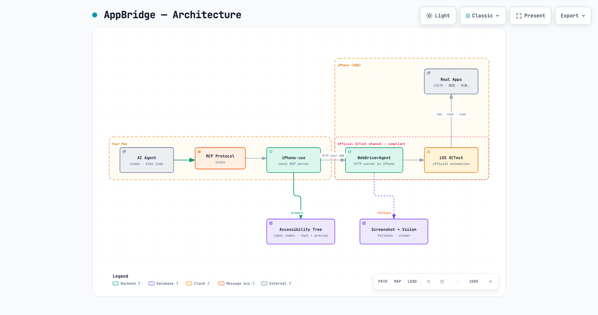

# AppBridge

> 让 AI agent 通过 USB 直连真实 iPhone，在真实 App 里像人一样浏览和操作，读取那些"只存在于 App 内、不开放 API"的信息。

*[English README](README_EN.md)*

---

AppBridge 是一套**社媒/App 信息采集方案**：以 [WebDriverAgent](https://github.com/appium/WebDriverAgent)（苹果官方 XCTest 自动化测试框架）为底座，通过 [MCP](https://modelcontextprotocol.io) 协议把 iPhone 的界面结构和操作能力暴露给 AI agent（Codex / Kimi Code / Claude Desktop / Cursor 等），并提供可直接复用的场景化采集脚本。

## 为什么是 AppBridge

国内重度依赖 App。小红书、微信公众号、抖音、微博、B站、知乎……大量有价值的信息分散在各家 App 里，**不开放 API、网页抓取容易触发风控、模拟网页操作会被平台安全机制拦截**。

AppBridge 换了一条路：**让 AI 在真实 App 里像人一样浏览**。底层用的是苹果官方的 XCTest 自动化通道（移动测试事实标准），平台看到的就是正常用户刷 App，因此**合规且不易被风控**。

### 核心价值

- **拿到"App-only"信息**：不开放 API、网页抓取易被封的内容
- **控件树直读**：主流 App 都有完整的无障碍控件树，直接做**结构化提取**——比截图 OCR 更快、更准、零模型成本
- **真实登录态**：用你手机上已登录的 App，无需处理账号密码/验证码
- **跨 AI 客户端**：基于 MCP 开放协议，一套服务，多个 AI 客户端共用
- **数据不出本机**：USB 直连，画面和数据留在本地

## 工作原理



*[交互式架构图（可缩放/导出）](docs/architecture.html)*

**信息提取分两层**（按 App 自适应，控件树优先）：

1. **控件树直读（首选）**：通过 WDA 的 `/source?format=json` 拿到带语义的元素（文本、类型、坐标），直接做结构化提取。快、准、零模型成本。
2. **截图 + 视觉模型（兜底）**：个别 App 控件树缺失时，退化为高清截图喂视觉模型做 OCR。仍能拿到信息，但慢且贵。

> ⚠️ **关键实现细节**：判断"App 是否有控件树"必须查 WDA 原生 `/source`，**不能用某些封装层的过滤结果**。iOS 上可读文本大多在元素的 `label` 字段而非 `name` 字段——按 `name` 过滤会误报为"无控件树"。详见 [docs/accessibility.md](docs/accessibility.md)。

## 实测：主流 App 控件树

| App | label 节点数 | 控件树 | 适配分级 |
|---|---|---|---|
| 抖音 | 74 | ✅ 丰富 | 内容消费，放心采集 |
| 微博 | 74 | ✅ 丰富 | 内容消费，放心采集 |
| B站 | 70 | ✅ 丰富 | 内容消费，放心采集 |
| 知乎 | 69 | ✅ 丰富 | 内容消费，放心采集 |
| 集换社 | 43 | ✅ 丰富 | 内容消费，放心采集 |
| 微信 | 43 | ✅ 丰富 | 内容消费，放心采集 |
| 小红书 | 38 | ✅ 丰富 | 内容消费，放心采集 |
| 淘宝 | 18 | ✅ 有 | ⚠️ **只读，不碰交易**（实测会触发风控登出） |

详见 [docs/app-tiers.md](docs/app-tiers.md) 的 App 适配分级与风控说明。

## 快速开始

### 前置条件

- macOS + 完整 **Xcode**（不是 Command Line Tools）
- **Apple 开发者账号**（免费账号即可，用于给 WDA 签名；免费账号 7 天后需重签）
- 一台 **iPhone**，USB 连接 Mac，信任、开开发者模式、保持解锁

### 1. 安装 iPhone-use（底座）

```bash
git clone https://github.com/zhongerxin/iPhone-use
cd iPhone-use && sh scripts/install.sh
```

按提示完成 Xcode 签名、WDA 构建、手机信任与开发者模式。详见 [docs/setup.md](docs/setup.md)。

### 2. 接入 AI 客户端

- **Codex**：见 [docs/codex.md](docs/codex.md)
- **Kimi Code**：见 [docs/kimi-code.md](docs/kimi-code.md)（编辑 `~/.kimi-code/mcp.json` 注册 `iphone_use` server 即可，零改动）

### 3. 跑一个场景

以"小红书找高互动的 GitHub 开源项目笔记"为例：

```bash
python3 scenarios/xiaohongshu/search_and_rank.py "GitHub 开源项目" --screens 4
```

输出按点赞数排序的结构化结果。更多场景见 [scenarios/](scenarios/)。

## 场景脚本

| 场景 | 目录 | 说明 |
|---|---|---|
| 小红书舆情/竞品采集 | [scenarios/xiaohongshu/](scenarios/xiaohongshu/) | 搜词 → 滚动 → 提取 → 按互动排序 |
| 通用"搜词→提取→排序" | [scenarios/generic/](scenarios/generic/) | 跨 App 的通用采集流程 |

## 合规与边界

- 本方案基于 **WebDriverAgent / 苹果官方 XCTest** 框架，仅用于**读取你自己设备上、你账号可见的公开信息**。
- **不涉及**逆向、越狱、私有协议，也不绕过平台安全机制。
- 请**遵守各平台服务条款**：内容消费类 App（小红书/微博/B站/知乎）可放心采集；**电商交易类（淘宝/京东）只读、不碰交易**；**金融支付类（支付宝/银行 App）不建议自动化**。
- 登录、支付、短信/人脸验证码等**敏感操作请由本人在手机上手动完成**，不要交给自动化。

## 已知边界与成本

- iPhone 必须 **USB 连 Mac**（不能无线）
- 需完整 Xcode + Apple 开发者账号签名 WDA（免费账号 7 天过期需重签）
- 真实 App 操作受动画/加载影响，约 8 秒/页（仍远快于手动）
- 跑任务时手机基本被 WDA 前台占用

## 致谢

- [WebDriverAgent](https://github.com/appium/WebDriverAgent) — iOS 自动化执行服务
- [zhongerxin/iPhone-use](https://github.com/zhongerxin/iPhone-use) — 本地 MCP server 与安装引导（本项目的底座）

## License

MIT
